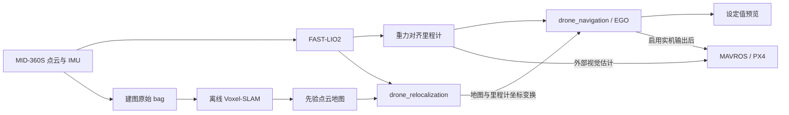

# Orange

Orange 是 Orange Pi 5 Max 上的 ROS 1 Noetic 工作空间，用于仓库无人机的激光惯性定位、先验地图导航和货架扫码。板端连接 MID-360S、相机与 PX4，Ubuntu 开发机通过 Docker 编译和测试。工作空间按功能分目录组织 ROS 包，部分实验与串口读码包通过 `CATKIN_IGNORE` 按需启用。

## 系统架构



- **通用巡检**　`drone_inspection` 从任务 YAML 加载巡检点、机头朝向和扫码动作，支持命令行和网页预设。[任务配置与验收](src/navigation/drone_inspection/README.md)
- **定位与导航**　`livox_ros_driver2` 提供点云和 IMU。FAST-LIO2 输出 `/Odometry` 和配准点云，重力桥输出 `/fastlio/odom_world`。重定位用先验地图确认一次 `drone_map → drone_odom` 变换，导航据此把地图航点转换到局部规划坐标系。导航默认发布到 `/drone_nav/setpoint_preview`。[建图说明](src/localization/drone_mapping/README.md) · [重定位说明](src/localization/drone_relocalization/README.md) · [导航接口](src/navigation/drone_navigation/README.md)
- **视觉巡检**　OV13855 的一路图像用于估计 AprilTag 位姿，另一路全分辨率图像用于读码。OV9281 可提供前视 ArUco 图像。`front_marker_control` 使用标记位姿做相对跟踪，室内 test4/test5 通过相机读码服务读取货架标签。[相机驱动](src/drivers/ov13855_cam/README.md) · [相机读码](src/perception/barcode_reader_camera/README.md)
- **板端与地面端**　板端的 roscore 和 MAVROS 由常驻服务提供，定位、采集和巡检入口位于 `scripts/`。Ubuntu 或 macOS 可通过 SSH 查看仓库监控，RViz 通过 Docker 显示地图、点云与轨迹。板端的网络与设备参数按本机配置填写。[板端配置](AGENTS.md#入口与本机配置) · [仓库监控](tools/warehouse_monitor/README.md) · [EGO RViz](tools/ego_rviz/README.md)

## 编译与测试

### Ubuntu 开发机与 CI

需要 Git 和 Docker，从仓库根目录运行。第一步联网构建 Ubuntu 20.04 / Noetic Desktop Full 依赖镜像，含 ZXing-C++ 和 AprilTag。随后导出当前提交到临时目录，在仅有回环网络的容器内编译和测试。构建产物和测试日志保存在 `$work`。

```bash
docker build -t orange/noetic-build:noetic docker/noetic-build

work="$(mktemp -d)"
git archive HEAD | tar -x -C "$work"
docker run --rm --pull=never --network none \
  --cap-drop=ALL --security-opt=no-new-privileges \
  --user "$(id -u):$(id -g)" -e HOME=/tmp -e GTSAM_JOBS=2 \
  --mount "type=bind,src=$work,dst=/ws" -w /ws \
  --entrypoint /bin/bash orange/noetic-build:noetic -ec \
  'scripts/build.sh -j2 -p1 --no-status && docker/noetic-build/test.sh'
```

GitHub Actions 在 push 和 pull request 时使用 Ubuntu amd64 runner，执行同一组构建与测试命令。测试入口运行 catkin 注册的单测和 `rostest`，用 `catkin_test_results build` 检查结果，再执行定位、导航、监控、合成录包和录像回归。CI 验收默认包在 amd64 上的离线行为，ARM64 和实机验收在板端进行。[工作流](.github/workflows/noetic.yml) · [测试入口](docker/noetic-build/test.sh) · [依赖版本与构建说明](docker/noetic-build/README.md)

### 已配置 Noetic 的板端

在已安装 Noetic、catkin-tools 和项目依赖的板端检出根目录运行。构建脚本先编译 `third_party/` 中的 Livox-SDK2 与 GTSAM 4.0.3，安装到当前检出的 `.deps/`，随后执行 `catkin build`。

```bash
GTSAM_JOBS=2 scripts/build.sh -j2 -p1 --no-status
source devel/setup.bash
```

## 目录结构

| 目录 | 说明 |
| --- | --- |
| `src/drivers/` | 雷达（MID-360S）、双相机（OV13855 / OV9281）、系留绞盘及按需串口读码驱动 |
| `src/localization/` | FAST-LIO2、重力对齐桥、离线先验建图（Voxel-SLAM）、重定位、漂移观测与车机坐标桥 |
| `src/navigation/` | 单机航点导航、巡检任务编排、前视视觉标记跟踪与实机 EGO 规划（`ego_swarm/`） |
| `src/perception/` | ArUco / AprilTag 位姿估计、相机读码与按需串口读码触发节点 |
| `src/visualization/` | TF 桥接与 RViz 配置 |
| `src/experiments/` | 相机/雷达标定、双相机同步录像及按需垂向控制辨识实验 |
| `scripts/` | 构建入口（`build.sh`）、板端常驻服务、室内外导航采集与归档脚本 |
| `tools/` | 仓库巡检监控（`warehouse_monitor`）、小车网页控制台（`car_web`）、RViz / 离线 EGO 演示与分析脚本 |
| `docker/` | Ubuntu / CI 构建测试镜像（`noetic-build`）与 RViz 容器（`ros-noetic-rviz`） |
| `third_party/` | 构建期编译并安装到 `.deps/` 的上游依赖（Livox-SDK2、GTSAM 4.0.3） |

各 ROS 包的节点接口、参数与用法见对应包目录内的 `README.md`，ROS 包名以各目录 `package.xml` 为准。

### 按需启用包与维护边界

- **按需构建**：包根目录带有 `CATKIN_IGNORE` 的包不参与常规构建和 CI，可在仓库根目录运行 `find src -name CATKIN_IGNORE` 查看当前清单。临时启用时，将该包及其按需依赖的 `CATKIN_IGNORE` 改名为 `CATKIN_IGNORE.off`，运行 `scripts/build.sh <ROS包名>`，实验结束后恢复标记。
- **串口读码依赖链**：`barcode_rc_trigger` 还需启用 `barcode_reader_serial`，`barcode_arrival_trigger` 需要同时启用这两个包。室内 test4/test5 使用默认启用的相机读码包 `barcode_reader_camera`。
- **EGO 源码边界**：实机 EGO 源码位于 `src/navigation/ego_swarm/`；`tools/ego_map_demo/official/` 保存离线演示的固定上游快照，独立构建。[离线地图演示](tools/ego_map_demo/README.md#源码与构建边界)
