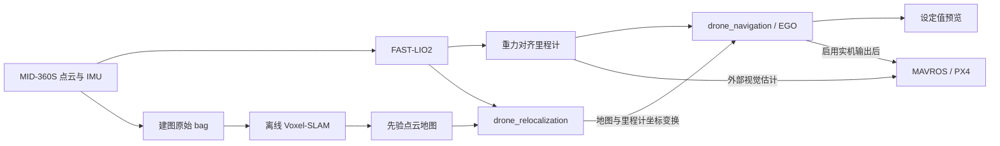

# Orange

Orange 是 Orange Pi 5 Max 上的 ROS 1 Noetic 工作空间，用于仓库无人机的激光惯性定位、先验地图导航和货架扫码。板端连接 MID-360S、相机与 PX4，Ubuntu 开发机通过 Docker 编译和测试。工作空间共有 **33 个 ROS 包，默认编译 27 个，另有 6 个按需启用**。

## 系统架构



- **定位与导航**　`livox_ros_driver2` 提供点云和 IMU。FAST-LIO2 输出 `/Odometry` 和配准点云，重力桥输出 `/fastlio/odom_world`。重定位用先验地图确认一次 `drone_map → drone_odom` 变换，导航据此把地图航点转换到局部规划坐标系。导航默认发布到 `/drone_nav/setpoint_preview`。[建图说明](src/localization/drone_mapping/README.md) · [重定位说明](src/localization/drone_relocalization/README.md) · [导航接口](src/navigation/drone_navigation/README.md)
- **视觉巡检**　OV13855 的一路图像用于估计 AprilTag 位姿，另一路全分辨率图像用于读码。OV9281 可提供前视 ArUco 图像。`front_marker_control` 使用标记位姿做相对跟踪，室内 test4/test5 通过相机读码服务读取货架标签。[相机驱动](src/drivers/ov13855_cam/README.md) · [相机读码](src/perception/barcode_reader_camera/README.md)
- **板端与地面端**　板端的 roscore 和 MAVROS 由常驻服务提供，定位、采集和巡检入口位于 `scripts/`。Ubuntu 或 macOS 可通过 SSH 查看仓库监控，RViz 通过 Docker 显示地图、点云与轨迹。板端的网络与设备参数按本机配置填写。[板端配置](AGENTS.md#入口与本机配置) · [仓库监控](tools/warehouse_monitor/README.md) · [EGO RViz](tools/ego_rviz/README.md)

## 编译与测试

### Ubuntu 开发机与 CI

需要 Git 和 Docker，从仓库根目录运行。第一步联网构建 Ubuntu 20.04 / Noetic Desktop Full 依赖镜像，含 ZXing-C++ 和 AprilTag。随后导出当前提交到临时目录，在仅有回环网络的容器内编译和测试。构建产物和测试日志保存在 `$work`。

```bash
docker build -t orange/noetic-build:noetic docker/noetic-build

work="$(mktemp -d)"
git archive HEAD | tar -x -C "$work"
docker run --rm --pull=never --network none \
  --cap-drop=ALL --security-opt=no-new-privileges \
  --user "$(id -u):$(id -g)" -e HOME=/tmp -e GTSAM_JOBS=2 \
  --mount "type=bind,src=$work,dst=/ws" -w /ws \
  --entrypoint /bin/bash orange/noetic-build:noetic -ec \
  'scripts/build.sh -j2 -p1 --no-status && docker/noetic-build/test.sh'
```

GitHub Actions 在 push 和 pull request 时使用 Ubuntu amd64 runner，执行同一组构建与测试命令。测试入口运行 catkin 注册的单测和 `rostest`，用 `catkin_test_results build` 检查结果，再执行定位、导航、监控、合成录包和录像回归。CI 验收默认包在 amd64 上的离线行为，ARM64 和实机验收在板端进行。[工作流](.github/workflows/noetic.yml) · [测试入口](docker/noetic-build/test.sh) · [依赖版本与构建说明](docker/noetic-build/README.md)

### 已配置 Noetic 的板端

在已安装 Noetic、catkin-tools 和项目依赖的板端检出根目录运行。构建脚本先编译 `third_party/` 中的 Livox-SDK2 与 GTSAM 4.0.3，安装到当前检出的 `.deps/`，随后执行 `catkin build`。

```bash
GTSAM_JOBS=2 scripts/build.sh -j2 -p1 --no-status
source devel/setup.bash
```

## ROS 包状态总表

包名取自各目录的 `package.xml`，点击包名可打开源码。**默认**表示进入常规构建和 CI，**按需**表示包根目录带有 `CATKIN_IGNORE`。是否启动某个节点由对应的 launch 或任务脚本决定。

| 目录分组 | ROS 包 | 构建状态 | 用途 |
| --- | --- | --- | --- |
| 驱动 | [livox_ros_driver2](src/drivers/livox_ros_driver2/) | 默认 | 发布 MID-360S 点云与 IMU |
| 驱动 | [ov13855_cam](src/drivers/ov13855_cam/) | 默认 | 通过 RKISP 和 GStreamer 采集跟踪与读码图像 |
| 驱动 | [ov9281_usb_cam](src/drivers/ov9281_usb_cam/) | 默认 | 采集 OV9281 USB 相机的 MJPEG 图像 |
| 驱动 | [barcode_reader_serial](src/drivers/barcode_reader_serial/) | 按需 | 触发外接串口读码器并读取结果 |
| 驱动 | [tether_winch_control](src/drivers/tether_winch_control/) | 默认 | 通过 TCP 控制系留绞盘占空比，支持模拟设备 |
| 定位 | [fast_lio](src/localization/FAST_LIO/) | 默认 | FAST-LIO2 激光惯性里程计与点云配准 |
| 定位 | [lidar_imu_init](src/localization/LiDAR_IMU_Init/) | 按需 | 估计雷达与 IMU 的外参、时间偏移及初始化状态 |
| 定位 | [fastlio_gravity_bridge](src/localization/fastlio_gravity_bridge/) | 默认 | 转换到重力对齐坐标系，可向 MAVROS 发布外部视觉估计 |
| 定位 | [fastlio_dll](src/localization/fastlio_dll/) | 默认 | 对照先验地图估计 FAST-LIO 漂移，支持旁路观测 |
| 定位 | [ywl_localization](src/localization/ywl_localization/) | 默认 | MID-360S 固定地图激光惯性定位实验 |
| 定位 | [voxel_slam](src/localization/voxel_slam/) | 默认 | 离线优化建图轨迹，供先验点云拼接 |
| 定位 | [drone_mapping](src/localization/drone_mapping/) | 默认 | 采集建图 bag，生成地图点云、元数据和预览 |
| 定位 | [drone_relocalization](src/localization/drone_relocalization/) | 默认 | 静止窗口内执行一次全局重定位，发布地图到里程计的变换 |
| 定位 | [car_bridge](src/localization/car_bridge/) | 默认 | 从车端 rosbridge 读取位姿，将车、机地图对齐到公共坐标系 |
| 导航 | [drone_navigation](src/navigation/drone_navigation/) | 默认 | 单机航点导航、轨迹预览与 PX4 设定值输出 |
| 导航 | [front_marker_control](src/navigation/front_marker_control/) | 默认 | 根据前视标记位姿生成机体系速度指令 |
| 导航 · EGO | [plan_env](src/navigation/ego_swarm/plan_env/) | 默认 | 管理先验与实时占据栅格 |
| 导航 · EGO | [path_searching](src/navigation/ego_swarm/path_searching/) | 默认 | 在栅格中进行 A* 路径搜索 |
| 导航 · EGO | [bspline_opt](src/navigation/ego_swarm/bspline_opt/) | 默认 | 优化 B 样条轨迹 |
| 导航 · EGO | [ego_planner](src/navigation/ego_swarm/plan_manage/) | 默认 | 管理规划、重规划状态机和轨迹服务 |
| 导航 · EGO | [quadrotor_msgs](src/navigation/ego_swarm/quadrotor_msgs/) | 默认 | 定义位置指令、轨迹等四旋翼消息 |
| 导航 · EGO | [traj_utils](src/navigation/ego_swarm/traj_utils/) | 默认 | 提供轨迹消息、多项式轨迹与规划可视化 |
| 感知 | [front_marker_vision](src/perception/front_marker_vision/) | 默认 | 检测前视 ArUco 标记并估计位姿 |
| 感知 | [ov13855_apriltag_vision](src/perception/ov13855_apriltag_vision/) | 默认 | 从 OV13855 图像检测 AprilTag 并估计位姿 |
| 感知 | [barcode_reader_camera](src/perception/barcode_reader_camera/) | 默认 | 用 AprilTag 确定标签区域，调用 ZXing-C++ 解码 |
| 感知 | [barcode_rc_trigger](src/perception/barcode_rc_trigger/) | 按需 | 用遥控器开关触发读码 |
| 感知 | [barcode_arrival_trigger](src/perception/barcode_arrival_trigger/) | 按需 | 标记跟踪到达保持位置后触发读码 |
| 可视化 | [orange_visualization](src/visualization/orange_visualization/) | 默认 | 提供 TF 桥接节点和 RViz 配置 |
| 实验 | [camera_calibration_pkg](src/experiments/camera_calibration_pkg/) | 默认 | OV13855 单目内参标定入口 |
| 实验 | [mid360s_calib](src/experiments/mid360s_calib/) | 默认 | 采集 MID-360S 与飞控外参标定所需的同步数据 |
| 实验 | [dual_camera_recorder](src/experiments/dual_camera_recorder/) | 默认 | 遥控触发双相机同步无损灰度录像 |
| 实验 | [vz_chirp_control](src/experiments/vz_chirp_control/) | 按需 | 垂向速度扫频响应实验 |
| 实验 | [vz_step_control](src/experiments/vz_step_control/) | 按需 | 垂向速度阶跃响应实验 |

临时启用按需包时，将该包及其按需依赖的 `CATKIN_IGNORE` 改名为 `CATKIN_IGNORE.off`，运行 `scripts/build.sh <包名>`，实验结束后恢复标记。`barcode_rc_trigger` 还需启用 `barcode_reader_serial`，`barcode_arrival_trigger` 需要同时启用这两个包。室内 test4/test5 使用默认启用的 `barcode_reader_camera`。

实机 EGO 源码位于 `src/navigation/ego_swarm/`。`tools/ego_map_demo/official/` 保存离线演示的固定上游快照，独立构建。[离线地图演示](tools/ego_map_demo/README.md#源码与构建边界)
